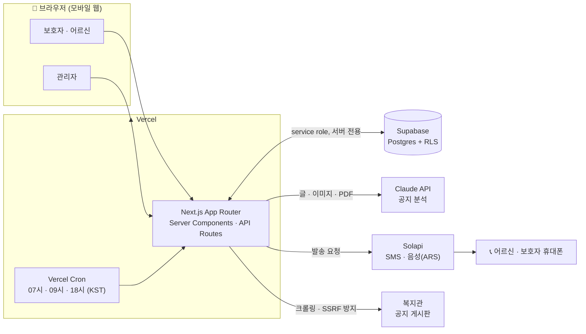
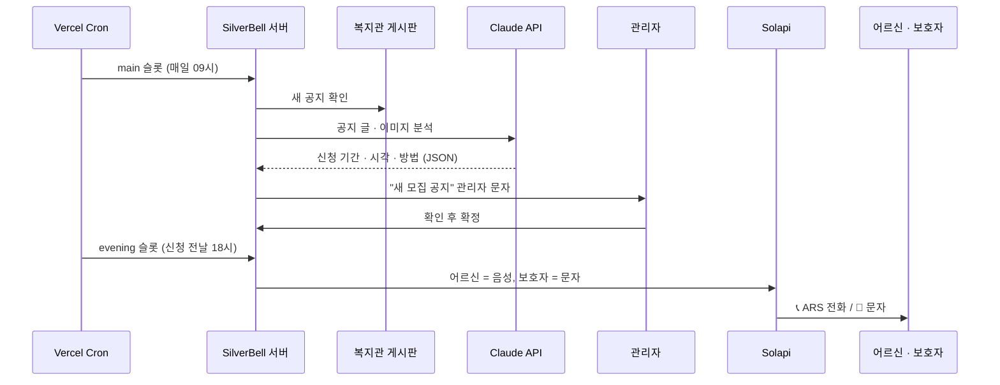
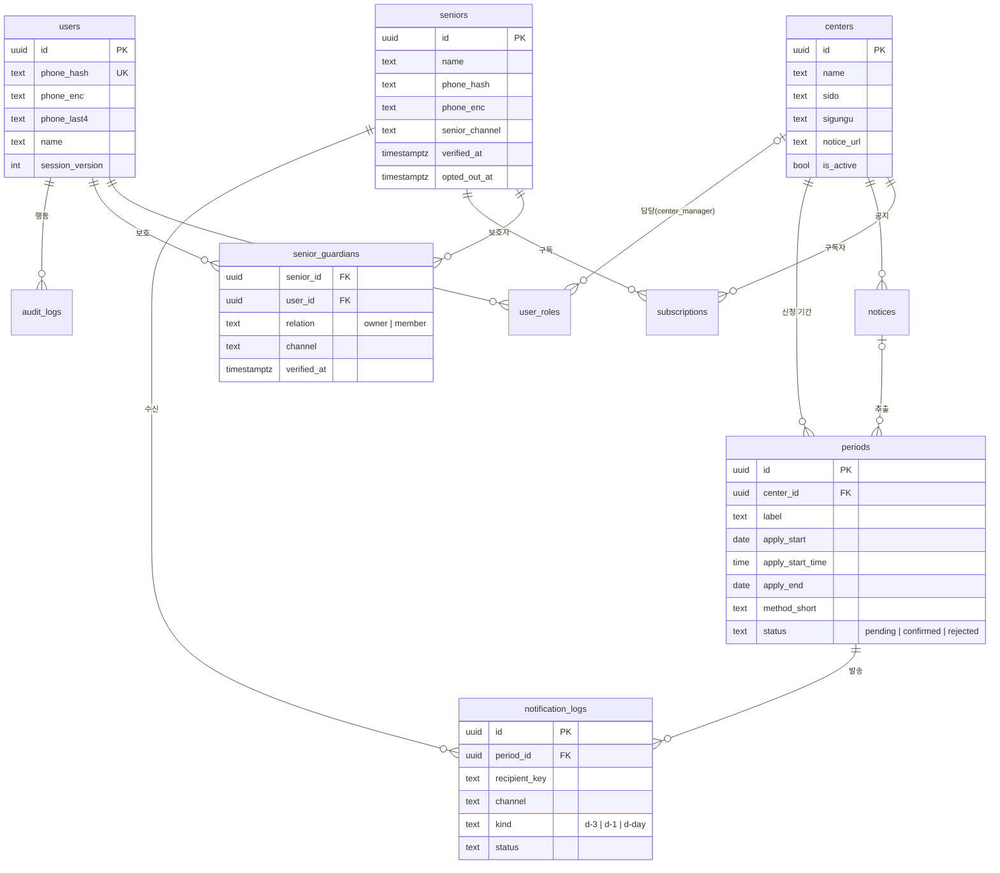

<div align="center">

# 🔔 SilverBell

**노인복지관 신청기간 알림 서비스**

복지관 모집 공지를 AI가 읽고, 신청이 시작되기 전에 어르신께 **전화(ARS)**로, 보호자께 **문자**로 알려 드립니다.


</div>


<br>
<br> 

> 📞 *"시립중랑노인복지관 안내입니다. 내일 아침 9시부터 하반기 프로그램 신청을 받습니다. 복지관 1층에 신분증을 가지고 방문하세요."*
> — 신청 전날 저녁 6시, 어르신 휴대폰으로 걸려 오는 안내 전화 (읽고 바로 끊김, 버튼 입력 없음)

<br>

## 목차

1. [프로젝트 개요](#1-프로젝트-개요)
2. [주요 기능](#2-주요-기능)
3. [시스템 아키텍처](#3-시스템-아키텍처)
4. [기술 스택](#4-기술-스택)
5. [설계 원칙](#5-설계-원칙)
6. [데이터 모델](#6-데이터-모델)
7. [알림 스케줄](#7-알림-스케줄)
8. [보안과 개인정보](#8-보안과-개인정보)
9. [프로젝트 구조](#9-프로젝트-구조)
10. [시작하기](#10-시작하기)
11. [배포](#11-배포)
12. [시연 시나리오](#12-시연-시나리오)
13. [한계와 로드맵](#13-한계와-로드맵)

<br>

## 1. 프로젝트 개요

### 문제

- 노인복지관마다 **공지 위치, 신청 기간, 신청 방법이 제각각**입니다.
- 인기 프로그램은 **시작일 아침 9시 선착순**으로 마감되는 경우가 많습니다.
- 한 번 놓치면 **다음 모집까지 약 6개월** 동안 복지관 활동이 끊깁니다.
- 어르신은 홈페이지 공지를 직접 확인하기 어렵고, 보호자는 여러 복지관을 매번 챙기기 어렵습니다.

### 해결

| 단계 | 하는 일 |
|---|---|
| **① 등록** | 보호자(또는 어르신 본인)가 전화번호로 가입해 어르신을 등록하고, 동네 복지관을 고릅니다. |
| **② 수집** | 서버가 매일 복지관 공지 게시판을 확인하고, **AI가 글·이미지·PDF 공지에서 신청 기간과 방법을 추출**합니다. |
| **③ 확정** | 관리자가 AI 결과를 확인하고 확정합니다. 오발송을 막기 위한 단계입니다. |
| **④ 알림** | 신청 **3일 전 · 전날 저녁 · 당일 아침**에 어르신께 ARS 전화나 문자를, 보호자께 문자나 전화를 자동으로 보냅니다. |

### 대상 사용자

| 사용자 | 설명 |
|---|---|
| 👵 **어르신** | 알림을 받는 사람. 앱을 쓰지 않아도 전화나 문자만으로 안내를 받습니다. |
| 👨‍👩‍👧 **보호자** | 어르신을 등록하고 관리합니다. 어르신 1명에 **보호자 최대 5명**까지 연결할 수 있습니다. |
| 🛠 **관리자** | 복지관과 공지를 관리하고 신청 기간을 확정합니다. 여러 명을 둘 수 있습니다. |

<br>

## 2. 주요 기능

### 사용자 (보호자 · 어르신)
- **전화번호 하나로 시작**: 별도 회원가입 없이 SMS 인증번호로 로그인합니다.
- **어르신 등록과 본인 확인**: 어르신 폰으로 간 확인 번호를 입력해야 알림이 시작됩니다. 남의 번호를 함부로 등록할 수 없습니다.
- **알림 방법 선택**: 어르신과 보호자가 각자 `전화` / `문자` / `둘 다` / `받지 않음` 중에서 고릅니다.
- **동네 복지관 고르기**: 시·도와 구·군을 큰 버튼으로 고르면 그 동네 복지관 목록이 나옵니다.
- **홈 화면**: "지금 신청할 곳"을 맨 위에 크게 보여 주고, "복지관에 전화하기" 버튼을 둡니다.
- **보호자 여러 명**: 보호자를 추가·해제하거나 나갈 수 있습니다. 대표 보호자(`owner`)가 나가면 다음 보호자에게 넘어갑니다.
- **알림 끄기(`/stop`)**: 어르신이 로그인하지 않고 본인 번호 인증만으로 알림을 끌 수 있습니다.
- **전 기능 CRUD**: 계정, 어르신, 보호자, 구독, 탈퇴까지 만들기·보기·고치기·지우기를 모두 지원합니다.

### 관리자
- **복지관 관리**: 복지관 CRUD, CSV 가져오기, "게시판 주소 없음" 필터를 제공합니다.
- **AI 공지 분석**: 게시판 자동 확인과 본문 붙여넣기 분석을 지원합니다. 텍스트, **이미지만 있는 포스터 공지**, PDF를 읽습니다.
- **확정 워크플로**: 확인 대기 → 확정 / 확정 취소 / 무시. 늦게 확정해도 놓친 알림을 따라잡아 보냅니다.
- **발송 관리**: 테스트 발송, 수동 발송, "음성 미리 듣기", 기간별 발송 내역을 볼 수 있습니다.
- **관리자 관리**: `super_admin`이 앱 안에서 관리자를 추가·변경·회수합니다. 재배포는 필요 없습니다.
- **감사 기록**: 관리자 행동을 모두 기록합니다.

<br>

## 3. 시스템 아키텍처



**한 번의 알림이 나가기까지**



<br>

## 4. 기술 스택

| 영역 | 기술 | 비고 |
|---|---|---|
| 프레임워크 | **Next.js** (App Router) · TypeScript | Next 16 `proxy.ts`로 라우트 보호 |
| 스타일 | **Tailwind CSS** | 어르신용 큰 글씨 · 큰 버튼 |
| 배포 · 스케줄 | **Vercel** · Vercel Cron | 하루 3개 슬롯 |
| 데이터베이스 | **Supabase** (PostgreSQL) | 서버 전용 접근, 모든 테이블 RLS |
| 문자 · 음성 | **Solapi** (`solapi` SDK) | SMS/LMS, 음성 메시지(TTS) |
| AI | **Claude API** (`@anthropic-ai/sdk`) | 텍스트 · 이미지 · PDF 공지 분석 |
| 크롤링 | `cheerio` | EUC-KR 디코딩, 같은 도메인 링크만 따라감 |
| 인증 · 세션 | `jose` (HS256 JWT) | httpOnly 쿠키, 자체 SMS OTP |
| 검증 · 테스트 | `zod` · `vitest` | |

> Supabase Auth는 국내 SMS 업체를 지원하지 않아서, 로그인은 Solapi SMS OTP로 직접 구현했습니다.

<br>

## 5. 설계 원칙

확장성을 처음부터 고려해 설계했습니다.

| # | 원칙 | 적용 |
|---|---|---|
| 1 | **권한은 DB에, 판단은 한 곳에서** | 모든 권한 판단은 `lib/authz.ts`의 `can(user, action, resource)`를 거칩니다. 역할을 코드에 하드코딩하지 않습니다. |
| 2 | **1:N 관계는 처음부터 연결 테이블로** | 관리자(`user_roles`), 보호자(`senior_guardians`), 구독(`subscriptions`) |
| 3 | **발송 수단은 교체 가능하게** | `MessageProvider` 인터페이스 뒤에 Solapi를 둡니다. 카카오 알림톡 등을 추가해도 호출부는 그대로입니다. |
| 4 | **자동 작업은 멱등 · 분할 처리** | unique 인덱스로 중복 발송을 막습니다. 배치 크기와 시간 예산(50초)을 두고, 남은 작업은 다음 실행이 이어받습니다. |
| 5 | **관리 행동은 기록** | 관리자 변경, 복지관 삭제, 기간 확정·취소, 수동 발송을 `audit_logs`에 남깁니다. |
| 6 | **목록은 전부 페이지네이션** | 한 번에 50개씩 보여 줍니다. |
| 7 | **문구 · 설정은 한 곳에** | 문구는 `lib/messages.ts`, 날짜는 `lib/dates.ts`, 숫자 설정은 `lib/config.ts`에 모았습니다. |

### 역할과 권한

| 역할 | 범위 | 권한 |
|---|---|---|
| `super_admin` | 전체 | 관리자 추가·삭제·역할 변경, 감사 기록 열람, `admin`의 모든 권한 |
| `admin` | 전체 | 복지관 CRUD, 공지 확인·분석, 기간 확정·취소, 발송, 자동 작업 실행 |
| `center_manager` | 지정 복지관 | 담당 복지관의 공지·기간 관리와 발송 *(P1)* |
| 보호자 | 연결된 어르신 | 어르신 정보·구독·보호자 관리 (`senior_guardians`로 판단) |

<br>

## 6. 데이터 모델

테이블은 14개이며, 모두 RLS를 켜고 정책은 두지 않았습니다. 서버의 service role로만 접근합니다.



| 구분 | 테이블 |
|---|---|
| 계정 · 권한 | `users`, `user_roles`, `otp_codes` |
| 어르신 · 보호자 | `seniors`, `senior_guardians`, `subscriptions` |
| 복지관 · 공지 | `centers`, `center_requests`, `notices`, `periods` |
| 발송 · 운영 | `notification_logs`, `audit_logs`, `job_runs`, `rate_limits` |

<br>

## 7. 알림 스케줄

복지관 접수는 **시작일 아침 9시 선착순**인 경우가 많아서, 시작일 9시에 알리면 이미 늦습니다. 그래서 하루 세 번 실행합니다.

| 슬롯 | 한국 시간 | 하는 일 |
|---|---|---|
| `morning` | 07:00 | **당일 알림** `d-day`: "오늘 아침 9시부터 신청을 받습니다" |
| `main` | 09:00 | **3일 전 알림** `d-3`, 게시판 확인과 AI 분석, 관리자 알림, 놓친 알림 따라잡기, 오래된 데이터 정리 |
| `evening` | 18:00 | **전날 저녁 알림** `d-1`: "내일 아침 9시부터 신청을 받습니다" |

- **중복 발송 방지**: `notification_logs (period_id, recipient_key, channel, kind)`에 unique 인덱스를 걸었습니다. 발송 전에 `queued` 행을 먼저 넣고, 충돌하면 건너뜁니다.
- **동시 실행 잠금**: `job_runs`에 `running` 행이 하나만 있을 수 있습니다. 15분이 넘게 멈춘 작업은 자동으로 정리합니다.
- **야간 발송 금지**: 21:00~07:00(KST)에는 알림을 보내지 않습니다. 인증번호 문자는 예외입니다.
- **AI 비용 상한**: AI 호출은 하루 200회까지입니다. 한도에 도달하면 분석을 멈추고 관리자에게 알립니다.
- **어르신 문자에는 링크를 넣지 않습니다.** 피싱 예방 교육을 받은 어르신에게 링크는 오히려 의심스러워 보입니다.

<br>

## 8. 보안과 개인정보

| 항목 | 방법 |
|---|---|
| **전화번호 암호화** | 검색용 `phone_hash`(HMAC-SHA256)와 저장용 `phone_enc`(AES-256-GCM)를 분리했습니다. 화면과 로그에는 `010-****-1234`로만 표시하고, 복호화는 발송 직전에만 합니다. |
| **DB 접근** | 모든 테이블에 RLS를 켜고 정책은 두지 않았습니다. `lib/db.ts`(`server-only`)에서만 service role로 접근합니다. |
| **세션** | httpOnly · SameSite=Lax · Secure 쿠키를 씁니다. 역할은 매 요청 DB에서 확인하고, `session_version`으로 모든 기기에서 로그아웃할 수 있습니다. |
| **OTP** | 해시(+pepper)로 저장하고 시도 횟수와 재전송 쿨다운을 제한합니다. IP·번호별 요청 수도 제한합니다. |
| **화이트리스트** | `ALLOW_PHONES`에 있는 번호만 OTP를 받고 알림을 받습니다. 비어 있으면 모두 거부합니다(fail-closed). |
| **CSRF** | 상태를 바꾸는 API는 `Origin`이 `APP_URL`과 같을 때만 허용합니다. |
| **SSRF** | 크롤링할 때 사설 IP와 localhost를 차단하고, 리다이렉트할 때마다 다시 검사합니다. |
| **프롬프트 인젝션** | 크롤링한 내용은 데이터로만 다루고, 공지 안의 지시문은 따르지 않도록 명시합니다. |
| **보안 헤더** | CSP(`frame-ancestors 'none'`), HSTS, `nosniff`, `Referrer-Policy`, `Permissions-Policy` |
| **개인정보** | 수집 항목과 목적을 알리고 동의를 받습니다. 탈퇴하거나 삭제하면 실제로 지웁니다(`on delete cascade`). |

<br>

## 9. 프로젝트 구조

```
silverbell/
├── app/
│   ├── login/                 # 전화번호 → 인증번호
│   ├── home/                  # 어르신별 카드, "지금 신청할 곳"
│   ├── seniors/               # 등록 · 확인 · 복지관 고르기 · 수정 · 보호자
│   ├── settings/  stop/       # 내 정보 · 탈퇴 / 어르신 알림 끄기
│   ├── privacy/   terms/      # 개인정보 처리방침 · 이용약관
│   ├── admin/                 # 관리자 홈 · members · audit
│   └── api/                   # otp · seniors · notify · admin · cron
├── lib/
│   ├── db.ts                  # Supabase 클라이언트 (server-only)
│   ├── authz.ts               # can() · 부트스트랩
│   ├── session.ts  otp.ts     # 세션 · OTP
│   ├── crypto/phone.ts        # 전화번호 해시 · 암호화
│   ├── notify/                # provider · solapi · demo · recipients · send
│   ├── analyze.ts             # Claude 공지 분석 (zod 검증)
│   ├── crawl.ts  fetch-media.ts
│   ├── jobs/run.ts            # runSlot(morning | main | evening)
│   ├── messages.ts  dates.ts  config.ts  next-step.ts
├── supabase/
│   ├── schema.sql
│   └── seed.sql
├── scripts/solapi-check.ts    # 문자 · 음성 실제 발송 확인
├── proxy.ts                   # 라우트 보호 (Next 16)
├── vercel.json                # Cron 3개
└── SPEC.md                    # 구현 명세
```

<br>

## 10. 시작하기

### 사전 준비

| 서비스 | 할 일 |
|---|---|
| [Supabase](https://supabase.com) | 프로젝트를 만들고(Seoul 리전) Project URL과 `service_role` key를 확인합니다. |
| [Solapi](https://solapi.com) | 가입하고 소액을 충전한 뒤, **발신번호를 사전 등록**하고 API Key와 Secret을 발급받습니다. |
| [Anthropic Console](https://platform.claude.com) | API 키를 발급받고 크레딧을 충전합니다. **월 사용 한도 설정을 권장**합니다. |

### 설치

```bash
git clone https://github.com/sdoaolo/SilverBell.git
cd SilverBell
npm install
cp .env.example .env.local
```

### 환경변수

```bash
# Supabase
SUPABASE_URL=
SUPABASE_SERVICE_ROLE_KEY=        # 서버 전용. NEXT_PUBLIC_ 금지

# Solapi
SOLAPI_API_KEY=
SOLAPI_API_SECRET=
SOLAPI_SENDER=                    # 사전 등록한 발신번호 (숫자만)

# Claude API
ANTHROPIC_API_KEY=
ANTHROPIC_MODEL=claude-sonnet-5-5

# 비밀값 (랜덤 생성)
SESSION_SECRET=
OTP_PEPPER=
CRON_SECRET=
PHONE_ENC_KEY=                    # 32바이트 base64. 잃어버리면 번호를 복구할 수 없음
PHONE_HASH_KEY=                   # 32바이트 base64. ENC 키와 다른 값

# 앱
APP_URL=http://localhost:3000
BOOTSTRAP_SUPER_ADMIN_PHONES=     # 첫 관리자 번호 (콤마 구분)
ALLOW_PHONES=                     # 허용 번호 (콤마 구분). '*'면 전체 허용
DEMO_MODE=true                    # true면 실제 발송 없이 콘솔 출력
```

랜덤 키 생성:

```bash
node -e "console.log(require('crypto').randomBytes(32).toString('base64'))"
```

> ⚠️ `PHONE_ENC_KEY`와 `PHONE_HASH_KEY`는 **같은 DB를 쓰는 모든 환경(로컬 · Vercel)에서 같은 값**이어야 합니다. 팀의 안전한 곳에 백업해 두세요.
> ⚠️ 키와 전화번호는 커밋, 채팅, 스크린샷에 절대 남기지 마세요. `.env.local`은 `.gitignore`에 포함되어 있습니다.

### DB 초기화

Supabase **SQL Editor**에서 순서대로 실행합니다.

1. `supabase/schema.sql`
2. `supabase/seed.sql` (시연용 복지관 · 신청 기간)

### 실행

```bash
npm run dev            # http://localhost:3000
npm test               # vitest
npx tsx scripts/solapi-check.ts 01012345678   # 문자 · 음성 실제 발송 확인
```

### 첫 관리자 만들기

1. `BOOTSTRAP_SUPER_ADMIN_PHONES`에 번호를 넣습니다.
2. 그 번호로 로그인하면 자동으로 `super_admin`이 됩니다.
3. 그다음 관리자는 **`/admin/members`에서 번호로 추가**합니다. 재배포는 필요 없습니다.

> 발신번호 주인의 휴대폰은 수신자(관리자 · 어르신 · 보호자)로 쓰지 마세요. 발신번호와 수신번호가 같으면 Solapi가 발송을 거부합니다.

<br>

## 11. 배포

1. Vercel에서 GitHub 저장소를 Import합니다(Framework Preset: **Next.js**).
2. **Settings → Environment Variables**에 위 환경변수를 등록합니다. `APP_URL`은 배포 주소로 바꿉니다.
3. Deploy를 실행하면 `vercel.json`의 Cron 3개가 자동으로 등록됩니다.

```json
{
  "crons": [
    { "path": "/api/cron/run?slot=morning", "schedule": "0 22 * * *" },
    { "path": "/api/cron/run?slot=main",    "schedule": "0 0 * * *" },
    { "path": "/api/cron/run?slot=evening", "schedule": "0 9 * * *" }
  ]
}
```

> Vercel Hobby 플랜의 Cron은 지정 시각에서 **최대 1시간 늦게** 실행될 수 있습니다. 정확한 시각이 필요하면 Pro 플랜이나 외부 스케줄러를 쓰세요.

<br>

## 12. 시연 시나리오

| # | 장면 | 확인할 점 |
|---|---|---|
| 1 | 보호자가 가입하고 어머니를 등록합니다(어르신은 전화, 보호자는 문자). | 어르신 폰에 **확인 번호 문자** → 입력하면 **안내 문자** 도착 |
| 2 | 동네를 골라 "내일 접수 시작"인 복지관의 알림을 켭니다. | 홈 맨 위 **"지금 신청할 곳"**에 표시 |
| 3 | 관리자가 `evening` 슬롯을 "지금 실행"합니다. | 어르신 폰에 **ARS 전화**, 보호자 폰에 **문자**가 동시에 도착 |
| 4 | 홈에서 "복지관에 전화하기"를 누릅니다. | 바로 전화 연결 |
| 5 | `super_admin`이 다른 팀원을 관리자로 추가합니다. | 추가된 관리자 폰에 안내 문자 |
| 6 | 복지관에서 "지금 확인"을 누르고 AI 분석 결과를 확정합니다. | **포스터 이미지 공지**에서도 기간 · 시각 · 방법 추출 |

<br>

## 13. 한계와 로드맵

**현재 한계**
- 자바스크립트로 그리는 게시판과 `.hwp` 첨부는 읽지 못해서, 본문을 붙여넣어 분석합니다.
- 오발송을 막기 위해 새 공지는 관리자가 확정해야 발송됩니다.
- Solapi 응답은 "접수" 기준이라 실제 수신 여부는 확인하지 않습니다.

**로드맵**
- [ ] `center_manager`: 복지관별 담당자 화면 *(스키마 · 권한 준비 완료)*
- [ ] Solapi 수신 결과 웹훅. 전화를 받지 못하면 문자로 다시 안내하고 보호자에게도 알림
- [ ] 마감 전날 알림 (선착순 · 상시 접수 공지 대응)
- [ ] 카카오 알림톡 추가와 실패 시 음성 대체 발송
- [ ] 공공데이터포털 복지시설 목록 연동
- [ ] 운영 전환: CAPTCHA, 백업(PITR), 에러 모니터링, 개인정보 처리방침 법무 검토

<br>

---

<div align="center">

자세한 구현 명세는 [`SPEC.md`](./SPEC.md)를 참고하세요.

**SilverBell** · 어르신의 복지관 생활이 끊기지 않도록

</div>
